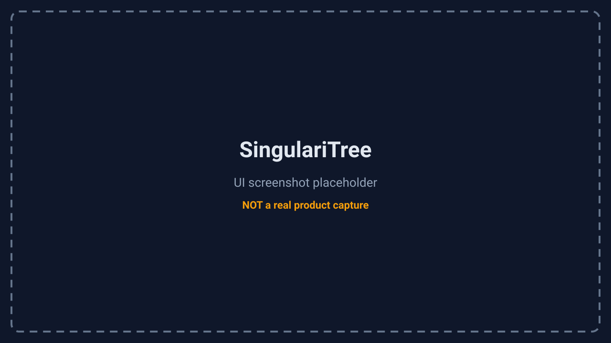

# SingulariTree

> **SingulariTree = git-client monorepo** — SourceTree-inspired multiplatform desktop Git client.
> Greenfield design under `docs/context/git-client/` (see `docs/context/git-client/INDEX.md`).
> Physical folder on disk is `SingulariTree/` (alias `git-client` per `docs/context/git-client/folder-structure.md §1`).
> Module alias: **Singularitree** (Go module `github.com/SingulariTree/go-core`, proto package `singularitree.v1` aka `gitclient.v1` for compatibility).

> **Documentación agent-facing:** punto de entrada [`docs/project.md`](docs/project.md) · índice generado [`docs/index.md`](docs/index.md) · contrato en [`docs/context/documentation-system.md`](docs/context/documentation-system.md).

Necomat `frontend/` (Angular 21 SPA `spa-necomat`) and `backend/` (Go 1.24 API `github.com/DavidRomaniuk/golang-api`) are **untouched** by this scaffold. SingulariTree is additive — see `docs/context/git-client/INDEX.md`.

## Monorepo Tree (source of truth: `docs/context/git-client/folder-structure.md §1`)

```
SingulariTree/                         <- monorepo root (physical folder SingulariTree, logical git-client)
├── apps/
│   ├── angular/                       <- Angular 21 renderer (zoneless signals, standalone)
│   │   └── src/app/{app,core,features/<feature>,shared,environments}
│   ├── electron/                      <- Electron shell (main + preload + ipc + window, supervisor)
│   │   └── src/{main,preload,ipc,window}
│   └── go-core/                       <- Go headless core (domain + services + adapters)
│       ├── cmd/go-core/main.go        <- Viper + DI + gRPC/HTTP, --headless flag
│       └── internal/{domain,service,repository,adapter/{git,grpc,http,watcher},config}
├── libs/
│   ├── contracts/                     <- Single contract source (proto -> gen/go + gen/ts)
│   │   ├── proto/{domain,errors,gitcore}.proto
│   │   └── gen/{go,ts}/              <- generated stubs (buf generate)
│   └── ui-kit/                        <- shared Angular UI kit (dumb components)
├── data/
│   └── sqlite/                        <- WAL per-user DB docs + migrations (runtime DB outside repo)
│       └── migrations/001_initial.sql
├── tools/
│   ├── scripts/{gen-contracts,build-go-core}.sh
│   └── ci/verify-contracts.sh
├── go.work                            <- Go workspace (use ./apps/go-core)
└── README.md
```

## Traceability

- Index: `docs/context/git-client/INDEX.md`
- Architecture (C4 + Hexagonal + headless proof): `docs/context/git-client/architecture.md`
- Folder structure: `docs/context/git-client/folder-structure.md`
- Module / hexagonal proof: `docs/context/git-client/module-diagram.md`
- Domain model (entities, SQLite tables, errors): `docs/context/git-client/domain-model.md`
- IPC strategy (preload bridge + gRPC/HTTP, proto sketch §2.3, supervisor §2.6): `docs/context/git-client/ipc-strategy.md`
- Service design (Go services, Angular stores, cache, watchers): `docs/context/git-client/service-design.md`

## Headless Proof (architecture.md §5)

Go core compiles and runs without Electron or Angular:

```bash
# from repo root SingulariTree/
go run ./apps/go-core/cmd/go-core --headless --grpc-addr unix:///tmp/singularitree-go.sock --db ~/.local/share/singularitree/cache.db

# compiled binary (ephemeral localhost ports):
./dist/go-core --headless --grpc-addr 127.0.0.1:0 --http-fallback-addr 127.0.0.1:0 --log-level info
# stdout when ready:
# GO_CORE_READY addr=unix:///tmp/singularitree-go.sock http=127.0.0.1:0 token=<32B hex>
```

Behavior in `--headless`:
- starts gRPC on Unix socket (Linux/macOS) or named pipe `\\.\pipe\singularitree-go-core` (Windows) and HTTP fallback on ephemeral localhost;
- prints `GO_CORE_READY addr=... http=... token=...` for supervisor discovery;
- health `Ping` every 5s; graceful shutdown on `SIGTERM`/`SIGINT`.

## Contracts

- Go module: `github.com/SingulariTree/go-core` (Go 1.25+)
- Proto package: `singularitree.v1` (alias `gitclient.v1` for compatibility — see `libs/contracts/proto/*.proto` header comments)
- Generation: `buf generate --template buf.gen.yaml` -> `libs/contracts/gen/go` + `libs/contracts/gen/ts`
- Breaking check: `buf breaking` via `tools/ci/verify-contracts.sh`

## Necomat Isolation

This monorepo does not modify `frontend/` or `backend/`. Workspace routing (`docs/project.md` Slices table) remains authoritative for Necomat; SingulariTree is documented as a greenfield topic folder under `docs/context/git-client/` until promoted to a slice.

## Quick Start

**Prerequisites:** Node >=20 (npm workspaces) · Go 1.25+ (the Go workspace targets 1.26) · `git` on `PATH`. Only for regenerating contracts: [`buf`](https://buf.build/docs/installation) — `./tools/scripts/gen-contracts.sh` fails fast if it is missing.

```bash
# 1. Install JS/TS dependencies (postinstall provisions the Electron binary)
npm ci

# 2. Build all three runtimes from the repo root
./tools/scripts/build-go-core.sh                    # -> dist/go-core (or dist/go-core.exe)
npm run build --workspace=@singularitree/angular    # -> apps/angular/dist/browser
npm run build --workspace=@singularitree/electron   # -> apps/electron/dist/main/main.js
# `npm run build` at the root builds every JS workspace (angular, electron, contracts, ui-kit).

# 3. Run the dev app (Angular `ng serve` + Electron, via concurrently + wait-on)
npm start
npm run start:electron-only                         # Electron shell only
npm run start:mock --workspace=@singularitree/electron   # mock core, opt-in via MOCK_GO_CORE=1
```

`MOCK_GO_CORE=1` is **strictly opt-in** — the real `go-core` is the default. The dev scripts build the shell, then launch Electron pointed at the Angular dev server (`http://localhost:4200`).

Tests (run from the **package directory**, never the repo root):

```bash
npm test --workspace=@singularitree/angular     # Angular vitest (`ng test --no-watch`)
npm test --workspace=@singularitree/electron    # Electron vitest (`vitest run`)
cd apps/go-core && go test ./...                # Go core
cd apps/electron && npx playwright test         # e2e smoke — needs the three builds above
```

Package (**UNSIGNED** — code signing / notarization is V1):

```bash
cd apps/electron
npm run pack   # unpacked dir -> apps/electron/release/
npm run dist   # installers   -> apps/electron/release/
```

Targets from `apps/electron/electron-builder.yml`: Linux `AppImage` + `deb`, Windows `nsis` + `portable`, macOS `dmg` + `zip`. Before packaging, `dist/go-core`, `apps/angular/dist/browser/` and `apps/electron/dist/main/` must exist — `extraResources` copies the renderer, core binary and `libs/contracts/proto` into the package. Build installers on the **target OS**: Windows `nsis` generally needs Windows or wine; macOS `dmg`/`zip` require macOS.

## Screenshots

> **Placeholder — no real screenshots committed yet.** The Electron GUI cannot be captured in this headless environment, so the image below is a labeled SVG placeholder, **not a product screenshot**.



Screenshots to capture manually and drop into `docs/assets/` (filenames and exact state in `docs/assets/README.txt`):

| # | Screenshot | State to capture |
|---|---|---|
| 1 | Repo picker | first launch, empty state |
| 2 | Commit graph | repo opened, a commit selected |
| 3 | Diff view | a diff open (once the diff UI lands; the current iteration is read-only graph + WIP) |
| 4 | Packaging artifact | `apps/electron/release/` after `npm run dist` (e.g. the AppImage) |

Replace `docs/assets/placeholder-screenshot.svg` with the real captures and update the image links above.
