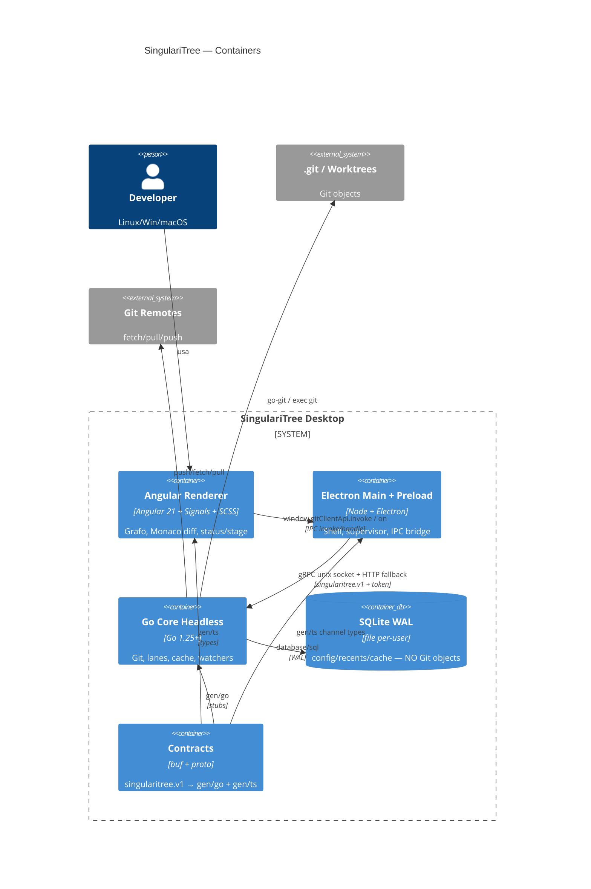
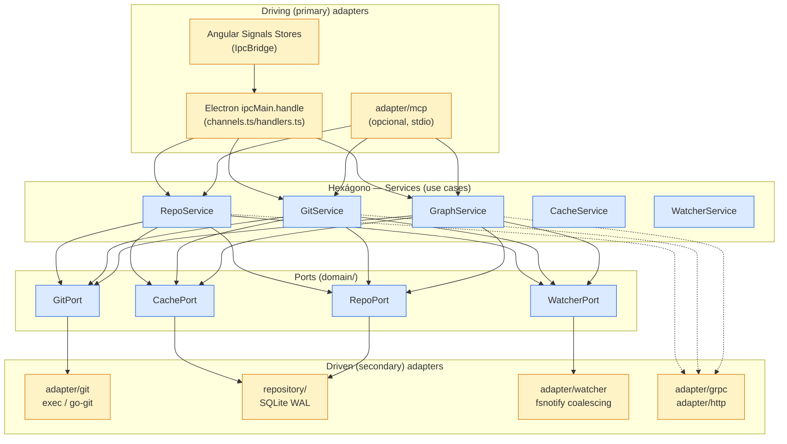
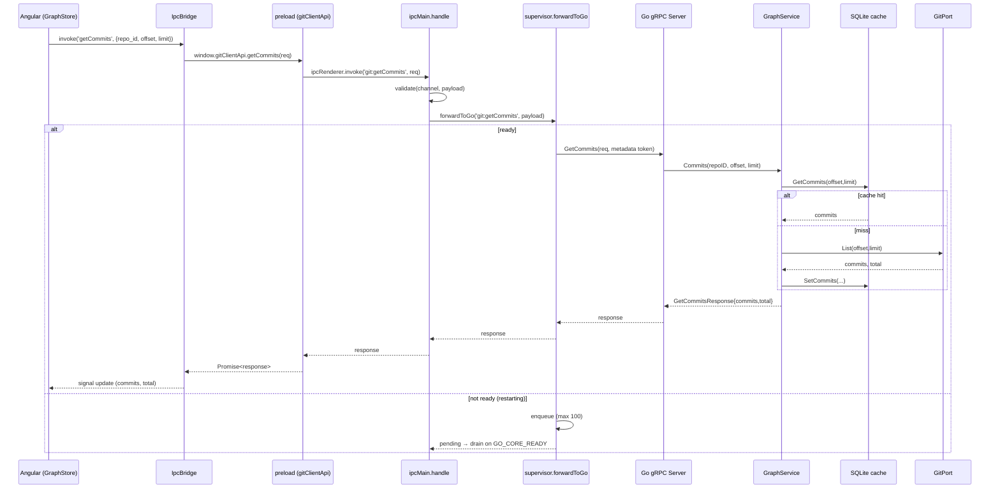
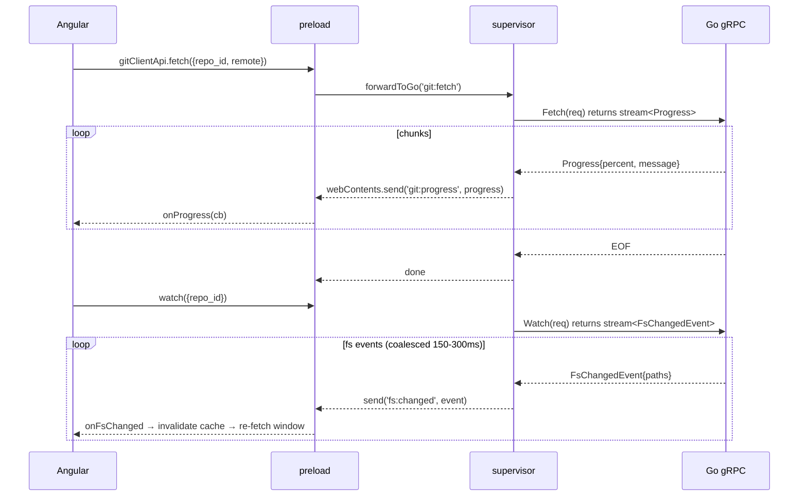
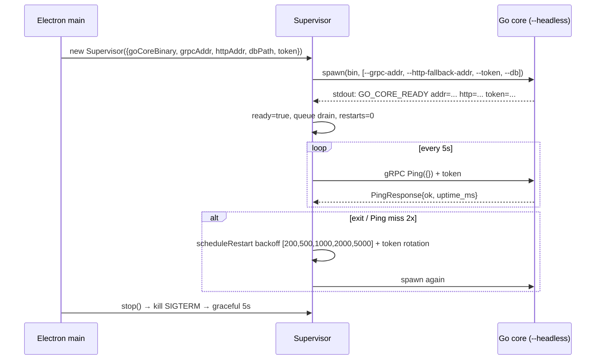

# Diagrama de módulos — C4 + Hexagonal + IPC

## 1. C4 Container (mermaid)



## 2. Hexagonal proof (mermaid)



**Prueba de sustituibilidad:**

| Cambio | Solo tocas | No tocas |
|--------|-----------|----------|
| Angular → React | `A` + `libs/ui-kit` | `Hex`, `Ports`, `Driven` |
| Electron → Tauri | `E` + `supervisor.ts` | `Hex`, `Ports` |
| `go-git` → exec git | `D1` | `S*`, `P1` |
| gRPC → solo HTTP | `D4` | `S*` |
| Añadir superficie MCP (opcional) | `adapter/mcp` + `cmd/mcp-server` | `Hex`, `Ports`, `Driven` |

`domain/` no importa `service/` ni `adapter/`; `service` solo conoce interfaces.

> MCP es un inbound adapter **opcional** sobre el mismo core Go (no altera el spine gRPC/`--headless`); ver ADR-013.

## 3. Secuencia IPC (request/response + streaming + watcher)

### 3.1 Request/response paginado (GetCommits)



### 3.2 Streaming (Fetch/Push/Watch)



### 3.3 Headless supervision



## 4. Módulos Angular (features verticales)

```
features/repo/
  ├── repo.routes.ts      <- lazy load
  ├── repo.service.ts     <- facade sobre IpcBridge (getCommits, getStatus…)
  ├── repo-models.ts      <- ViewModels (CommitRow, Lane)
  ├── page/repo-page.ts   <- orquesta graph + status + diff
  └── ui/
      ├── graph/          <- virtual scroll + lanes canvas
      ├── status/         <- stage/unstage, file list
      ├── diff/           <- Monaco side-by-side/unified
      ├── branches/       <- branches/tags/stashes/worktrees
      └── toolbar/        <- fetch/pull/push + progress bar
```

Cada feature tiene su **Signals store** (ver `service-design.md §2`): `GraphStore`, `StatusStore`, `DiffStore`, `BranchStore`.

## 5. Módulos Go (internal)

| Módulo | Depende de | Expone |
|--------|------------|--------|
| `domain` | nada (puro) | entidades, VOs, ports interfaces, errores |
| `service` | `domain` ports | casos de uso, validación, transacciones |
| `repository` | `domain`, `database/sql` | SQLite impl de `RepoPort`, `CachePort` |
| `adapter/git` | `domain` | `GitPort` via exec/go-git |
| `adapter/grpc` | `service`, `gen/go` | `GitCore` gRPC server, interceptors token/auth |
| `adapter/http` | `service` | fallback REST `/health`, `/commits`, etc. |
| `adapter/watcher` | `domain` | `WatcherPort` fsnotify |
| `adapter/mcp` *(opcional)* | `service`, `gen/go` | MCP server (stdio), tools `git_<verb>` — ver ADR-013 |
| `config` | Viper, flags | `Config` struct |
| `cmd/go-core` | todos | DI wiring, listeners, graceful shutdown |
| `cmd/mcp-server` *(opcional)* | todos | composition root MCP; wiring compartido vía `internal/bootstrap` |

## 6. Dependencias externas

- `modernc.org/sqlite` o `mattn/go-sqlite3` (CGO) + `fsnotify`
- `google.golang.org/grpc` + `connect` opcional
- `spf13/viper` + `spf13/cobra` o `flag`
- `buf` (Contracts) + `stephenh/ts-proto` (gen/ts)
- Angular CDK (virtual scroll) o canvas; `monaco-editor` + `monaco-workers`

## 7. Verificación del diagrama

- `domain/` no importa `service/` ni `adapter/` → `go vet ./...` + import cycle check.
- Angular `ng build` sin Electron — `window.gitClientApi` mockeado en `environments`.
- Go `go run --headless` sin Angular/Electron — `GO_CORE_READY` emitido.
```
