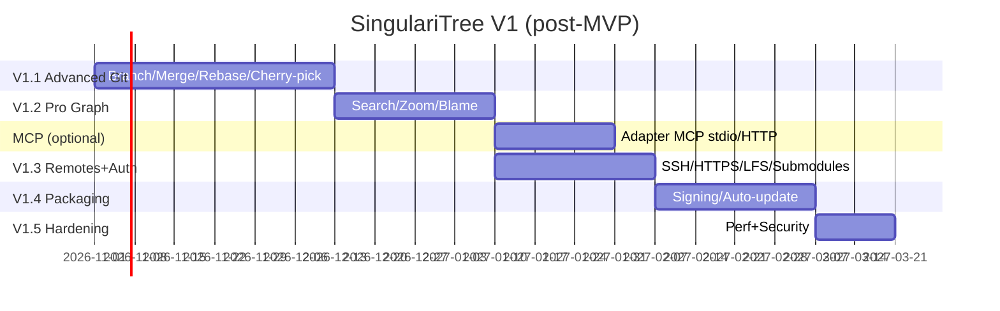

# Roadmap V1 — 16-20 weeks post-MVP

> V1 = MVP : advanced merge/rebase/cherry-pick, conflict UI, full worktrees, submodules, LFS awareness, SSH auth, signed commits, bisect/blame hooks, graph search/filter, bisect, reflog, stash apply/pop, patch apply, remote CRUD, settings, keybindings, signed packaging, auto-update, large-repo perf 100k.

## Phase V1.1 — Advanced Git (wk 1-6 post-MVP)

| Feature | Go | Angular | Notes |
|---------|----|---------|-------|
| **Branch create/rename/delete** | `GitPort.CreateBranch`, `DeleteBranch` | `BranchStore` CRUD modal | `BRANCH_EXISTS` handling |
| **Merge** | `Merge(ref, strategy, no-ff)` | merge dialog + conflict state | exposes `has_conflict_markers` in Diff |
| **Rebase interactive** | `Rebase(base, onto, interactive)` | rebase todo editor (reorderable commit list) | streaming logs |
| **Cherry-pick** | `CherryPick(oid)` | cherry-pick from history context menu | |
| **Revert** | `Revert(oid)` | revert commit | |
| **Tag create/delete/push** | `CreateTag(name, annotated, message)` | tag dialog | push tags |
| **Worktrees full CRUD** | `AddWorktree`, `RemoveWorktree` | worktree manager page | |
| **Stash apply/pop/drop** | `StashApply`, `Pop`, `Drop` | stash context menu | |
| **Conflicts UI** | `Diff.has_conflict_markers` | Monaco conflict editor (3-way) | blocker |

**DoD V1.1:** merge/rebase/cherry-pick with conflicts visible and resolvable without a terminal.

## Phase V1.2 — Pro Graph + search (wk 7-10)

- **Graph search/filter:** by message, author, short oid, branch/topo; highlighting in lanes.
- **Zoom/minimap:** scalable lanes, canvas minimap.
- **Keyboard nav:** `j/k`, `g→top`, `/ search`, `c commit`, `s stage`.
- **Blame/File history:** `git blame` and `git log -- <path>` per file.
- **Reflog view:** `git reflog` streaming.
- **Lane performance:** incremental lanes for 100k, workers for lane computation if >50k.

**DoD:** searchable 100k-commit graph, keyboard-only usable.

## Optional workstream — MCP surface (MCP-A/B/C)

> **Optional** and decoupled from the spine; it does not block any phase. Recorded in **ADR-013**. It sits between the MVP and the hosting integrations (V1.3). MCP is an inbound adapter over the same Go core (`adapter/mcp` + `cmd/mcp-server`), consumed by AI clients headlessly (without Electron/Angular).

| Phase | Scope | Deliverable |
|------|---------|------------|
| **MCP-A** | Read-only | `adapter/mcp` + `cmd/mcp-server` (stdio); read tools (`git_ping`, `git_get_commits`, `git_get_status`, `git_get_diff`, `git_events`…); JSON Schema generated from proto |
| **MCP-B** | Writes + progress/cancel | Mutation set behind `--allow-write` (`git_stage`/`git_commit`/`git_fetch`…); `Progress`→`notifications/progress`; `notifications/cancelled`→context-cancel (closes R12) |
| **MCP-C** | Streamable HTTP + resources/prompts | MCP HTTP on loopback (per-session Bearer + Origin check); resources/prompts; shared DI via `internal/bootstrap` |

**DoD:** `cmd/mcp-server` runs headless against the Go core without Electron/Angular; MCP schemas generated from `gitcore.proto`; no second writer to `cache.db` (R13).

## Phase V1.3 — Remotes & Auth (wk 11-14)

- **Remote CRUD:** add/rename/remove remote, fetch_specs edit.
- **SSH:** `ssh-agent` + key file + passphrase UI, `GIT_SSH_COMMAND` wiring.
- **HTTPS:** credential helper (libsecret/Keychain/wincred) + token prompt.
- **LFS awareness:** `git lfs` status (does not implement LFS, only detects).
- **Submodules:** list + update + diff.
- **Signed commits:** GPG/SSH signing passthrough.

**DoD:** `fetch/pull/push` with private SSH/HTTPS works cross-platform.

## Phase V1.4 — Packaging & Polish (wk 15-18)

- **Signing:** macOS notarization, Windows sign, Linux flatpak/appimage.
- **Auto-update:** `electron-updater` (GitHub Releases).
- **Settings:** git config editor (user.name/email, core.autocrlf, etc.), theme, keymap, external diff tool.
- **Onboarding:** welcome wizard (open/create/clone repo).
- **Optional telemetry:** opt-in usage metrics (no Git data).
- **i18n:** es/en locales.
- **Accessibility:** ARIA in graph-row, Monaco keyboard nav.

**DoD:** signed installers + auto-update on 3 OSes.

## Phase V1.5 — Hardening (wk 19-20)

- Large repo perf audit (git.git, chromium, linux kernel shallow).
- Watcher stress (burst 1000 files, `git checkout main`).
- SQLite WAL concurrency (multiple Electron windows = one Go core).
- Security audit preload/CSP/token.
- Final docs + migration guide.

## Visual timeline

## V1 Dependencies

- V1.1 blocks V1.2 (merge logic first).
- V1.3 can overlap with V1.2 (different ports: GitPort vs GraphService).
- MCP workstream (optional) can overlap with V1.1-V1.3; does not block phases (ADR-013).
- Packing (V1.4) requires V1.1-1.3 stable.

## V1 Exit Criteria

- [ ] Full merge/rebase/cherry-pick/revert/tag/worktree/stash without a terminal.
- [ ] 100k graph + search/filter + minimap + keyboard.
- [ ] SSH/HTTPS auth, remote CRUD, submodules list, LFS awareness.
- [ ] Signed installers on 3 OSes + auto-update.
- [ ] Coverage ≥80%, e2e on 3 OSes, perf benchmark <16ms/frame 100k graph.
- [ ] `buf breaking` never broke contracts without a major.
